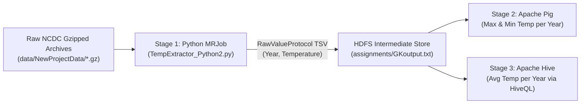

# Big Data Engineering, Distributed Computing & Analytics

[](https://hadoop.apache.org/)
[](https://spark.apache.org/)
[](https://hive.apache.org/)
[](https://pig.apache.org/)
[](https://www.python.org/)
[](https://openjdk.org/)
[](https://aws.amazon.com/emr/)

A comprehensive repository of distributed data processing pipelines, MapReduce applications, Apache Spark analytics, Pig & Hive ETL workflows, custom User-Defined Functions (UDFs), and foundational coursework for **BAN 632: Big Data Technology and Applications**.

---

## 🛠️ Tech Stack, Tools & Platforms

| Domain | Technologies & Tools |
| :--- | :--- |
| **Distributed Storage & Cluster** | **Apache Hadoop (HDFS)**, **YARN ResourceManager**, **NameNode / DataNode**, **MapReduce JobHistory Server**, **Hadoop Archives (`.har`)**, **AWS EMR (Elastic MapReduce)**, **Amazon S3** |
| **Batch & Stream Processing** | **Hadoop MapReduce (Java API)**, **Hadoop Streaming (`hadoop-streaming-2.9.0.jar`)**, **MRJob (Python)**, **Apache Spark (Core RDDs & Spark SQL / DataFrames)** |
| **Data Warehousing & ETL** | **Apache Hive (HiveQL, Derby Metastore, `schematool`)**, **Apache Pig (Pig Latin, Grunt Shell)** |
| **Big Data Ecosystem** | **Apache HBase** (NoSQL Columnar Store), **Apache ZooKeeper** (Distributed Coordination), **Apache Sqoop** (RDBMS-to-HDFS Ingestion) |
| **Programming Languages** | **Python** (`mrjob`, `pyspark`, `csv`, `sys`, `re`), **Java** (Hadoop MapReduce API, Custom Hive/Pig UDFs), **SQL / HiveQL**, **Pig Latin**, **Bash / Shell** |
| **Testing & Build Tools** | **Apache MRUnit** (`mrunit-1.0.0-hadoop2.jar`), **JUnit 4** (`junit-4.11.jar`), **Apache Commons CLI & Logging**, **Java Archive (`jar`) & Compiler (`javac`)** |

---

## 🧠 Core Data Engineering Skills Demonstrated

- **Distributed File System Administration (HDFS)**:
  - Managing distributed directories, permissions (`chmod`), block health verification (`hdfs fsck -files -blocks`), file transfers (`-copyFromLocal`, `-copyToLocal`), and bundling small files with **Hadoop Archives (`hadoop archive` / `har://`)**.
  - Cross-environment execution across **on-premise Linux Hadoop clusters** and **cloud-managed AWS EMR clusters** backed by **S3**.
- **MapReduce Algorithm Design & Optimization**:
  - Designing **Single-Step and Multi-Step MapReduce pipelines** (`MRStep`), **Combiners** for local map-side aggregation, and **Secondary Sorting** across composite keys.
  - Implementing **Custom Counters** (`increment_counter` / `reporter:counter`) to track malformed records, missing sentinel values, and agency/department distributions at scale.
  - Partitioning datasets dynamically across multiple output files using `MultipleOutputs` and custom record parsers.
- **High-Volume Meteorological Data Parsing (NCDC Weather Corpus)**:
  - Fixed-width byte-offset extraction of station identifiers (USAF/WBAN), observation dates, signed air temperatures (tenths of degrees Celsius), sentinel filtering (`±9999`), and quality control flag validation (`[01459]`).
  - Native handling of compressed `.gz` streams and binary **Hadoop `SequenceFile`** I/O.
- **Apache Spark & PySpark Distributed Analytics**:
  - Low-level **RDD Transformations & Actions** (`textFile`, `flatMap`, `map`, `reduceByKey`, `saveAsTextFile`) and partition topology inspection using `glom()`.
  - Structured **Spark SQL / DataFrame** ingestion with explicit `StructType` schema enforcement and distributed CSV sinks.
- **Multi-Engine End-to-End ETL (MRJob → Apache Pig → Apache Hive)**:
  - Building interoperable pipelines using `RawValueProtocol` to emit clean TSV streams from Python MapReduce jobs directly into **Apache Pig** (for yearly min/max aggregations) and **Apache Hive** (for warehouse table loading and average temperature analytics).
- **Custom UDF Development & MapReduce Unit Testing**:
  - Authoring, compiling, and registering custom Java **User-Defined Functions (UDFs)** for Pig (`Trim.java`) and Hive (`Strip.java`).
  - Unit testing Mapper/Reducer logic in isolation prior to cluster deployment using **MRUnit** and **JUnit 4**.

---

## 🏗️ End-to-End Course Project Architecture

The capstone project (`assignments/CourseProject-1.docx`) implements a three-stage distributed analytics pipeline over 100+ raw compressed **NCDC meteorological station archives** (`data/NewProjectData/`):



1. **Stage 1 — Ingestion & Parsing (Python MRJob on Hadoop)**:
   - [`code/TempExtractor_Python2.py`](code/TempExtractor_Python2.py) parses raw fixed-width NCDC weather strings, filters out `9999` missing sentinels, and outputs clean `<year>\t<temp>` pairs using `RawValueProtocol`.
2. **Stage 2 — Extremes Aggregation (Apache Pig)**:
   - Loads the extracted TSV dataset into Pig relations, groups observations by `year`, and computes annual `MAX` and `MIN` temperatures across all reporting stations.
3. **Stage 3 — Warehouse Analytics (Apache Hive)**:
   - Loads the TSV dataset into a managed Hive table and executes HiveQL aggregations (`AVG(temperature) GROUP BY year`) for historical climate trend analysis.

---

## 📁 Repository Structure

```text
Big-Data/
├── assignments/     # Homework 1 & 2, Course Project specs, execution logs & reports
├── code/            # MapReduce (Java & Python MRJob), Hadoop Streaming & PySpark scripts
├── data/            # NCDC weather archives (1930 & 100-station corpus), CSVs, Pig scripts
├── docs/            # Textbook (Hadoop: The Definitive Guide), command guides & MRJob notes
├── jars/            # Hadoop 2.6/2.9, Hive 0.13, Pig 0.11, JUnit 4.11 & MRUnit 1.0 JARs
└── lectures/        # Full course slide decks (Ch 1–15 + Spark), syllabus & past exam questions
```

---

## 💻 Highlighted Code & Implementations (`code/`)

### 1. Python MapReduce (`MRJob` & Hadoop Streaming)
| File | Description & Key Concepts |
| :--- | :--- |
| [`TempExtractor_Python2.py`](code/TempExtractor_Python2.py) | **Course Project Stage 1**: Extracts `(Year, Temperature)` from NCDC records using `RawValueProtocol` for downstream Pig/Hive consumption. |
| [`neg10_1930_PYTHON2.py`](code/neg10_1930_PYTHON2.py) | **Homework 2**: Multi-key `MRStep` job that filters 1930 NCDC records for exact `-10.0°C` (`-100` tenths) readings with valid quality flags (`01459`), emitting both detailed station/date matches and a global total count. |
| [`avg.py`](code/avg.py) | **Multi-Step Chained MapReduce**: Two-stage `MRStep` pipeline over `salaries.csv` that computes average annual salary by job title (filtering groups with `count > 3`), increments custom agency counters, and ranks the **Top 10** highest-paying roles. |
| [`top_salary.py`](code/top_salary.py) | **Top-N Pattern with Combiner**: Computes the top 10 annual salaries and gross pays in parallel using an in-mapper/combiner top-10 heap reduction pattern and custom warning counters. |
| [`secondarySort.py`](code/secondarySort.py) | **Secondary Sorting in MRJob**: Sorts composite `(Year, Temperature)` values in descending order per year and extracts the annual maximum temperature. |
| [`secondary_sort_map.py`](code/secondary_sort_map.py) & [`secondary_sort_reduce.py`](code/secondary_sort_reduce.py) | **Hadoop Streaming Secondary Sort**: Native `stdin`/`stdout` Python mapper and reducer with Hadoop stderr counter reporting (`reporter:counter:Temperature,Missing,1`). |
| [`word_count.py`](code/word_count.py) | Classic distributed word frequency counter built with `MRJob`. |

### 2. Apache Spark (`PySpark`)
| File | Description & Key Concepts |
| :--- | :--- |
| [`WordCountSP.py`](code/WordCountSP.py) | Distributed WordCount using `SparkContext`, `flatMap`, `map`, and `reduceByKey` saving results directly to HDFS. |
| [`ReadSpark.py`](code/ReadSpark.py) | **Spark SQL DataFrame Pipeline**: Enforces a typed `StructType` schema (`Title`, `Author`, `Genre`, `Height`, `Publisher`) on `GoodBooks.csv` and writes partitioned CSV output to HDFS. |
| [`Glom.py`](code/Glom.py) | Demonstrates RDD partition boundaries in memory using Spark's `glom().collect()` transformation. |
| [`CatSpark.py`](code/CatSpark.py) | Reads unstructured HDFS text files via `SparkSession` DataFrame API. |

### 3. Java MapReduce
| File | Description & Key Concepts |
| :--- | :--- |
| [`MaxTemperature.java`](code/MaxTemperature.java) | Job driver configuring `FileInputFormat`, `FileOutputFormat`, `Text` keys, and `IntWritable` values. |
| [`MaxTemperatureMapper.java`](code/MaxTemperatureMapper.java) | Parses NCDC fixed-width lines, validates quality regex `[01459]`, and emits `(Year, Temp)` pairs. |
| [`MaxTemperatureReducer.java`](code/MaxTemperatureReducer.java) | Iterates over `Iterable<IntWritable>` values per year to emit the maximum recorded temperature. |

---

## 📊 Datasets (`data/`)

- **[`NewProjectData/`](data/NewProjectData)** & **[`NewProjectData.zip`](data/NewProjectData.zip)**: 100 gzipped NCDC meteorological station files (`1930–1939`) used in the Course Project.
- **[`1930.zip`](data/1930.zip)**: Full 1930 NCDC weather station archive used in Homework 2.
- **[`salaries.csv`](data/salaries.csv)**: Public sector employee compensation dataset (`18,980+` rows: `Name, JobTitle, AgencyID, Agency, HireDate, AnnualSalary, GrossPay`).
- **[`GoodBooks.csv`](data/GoodBooks.csv)**: Curated book metadata dataset for Spark SQL schema exercises.
- **[`movies`](data/movies)**: MovieLens (`u.item`) pipe-delimited movie genre dataset (`1,682` titles).
- **[`SparkBookInText.txt`](data/SparkBookInText.txt)**: Large text corpus for Spark & MapReduce text processing benchmarks.
- **[`grunt.zip`](data/grunt.zip)**: Collection of **Apache Pig Latin** scripts (`combine.grunt`, `disambiguate.grunt`, `flatten.grunt`, `foreach.grunt`, `group.grunt`, `join.grunt`, `max_temp.grunt`, `missing.grunt`, `multiquery.grunt`).
- **[`sample.txt`](data/sample.txt)**, **[`sample.txt.gz`](data/sample.txt.gz)**, **[`quangle.txt`](data/quangle.txt)**, **[`input.txt`](data/input.txt)**, **[`dummy2.txt`](data/dummy2.txt)**: Benchmark and unit-test input fixtures.

---

## 📚 Assignments, Documentation & Lecture Modules

### Assignments & Reports (`assignments/`)
- **Homework 1**: [`HomeworkAssignment1.docx`](assignments/HomeworkAssignment1.docx) / [`.pdf`](assignments/HomeworkAssignment1.pdf) & Solution Report [`RN7945BDAf-1.docx`](assignments/RN7945BDAf-1.docx) — Rewriting Java MapReduce examples in Python using Hadoop Streaming and MRJob.
- **Homework 2**: [`HomeworkAssignment2-1.docx`](assignments/HomeworkAssignment2-1.docx) & Solution Report [`RN7945HW2BD-1.pdf`](assignments/RN7945HW2BD-1.pdf) ([`annotated`](assignments/annotated-RN7945HW2BD-1.pdf)) — Filtering and counting `-10°C` observations in 1930 across NCDC stations.
- **Course Project**: [`CourseProject-1.docx`](assignments/CourseProject-1.docx), Extracted Output [`GKoutput.txt`](assignments/GKoutput.txt) (`130,421` records), & Execution Report [`RN7945BDFCMDS.pdf`](assignments/RN7945BDFCMDS.pdf).

### Technical Guides & Reference (`docs/`)
- **[`Hadoop_The_Definitive_Guide_Third_Edition.pdf`](docs/Hadoop_The_Definitive_Guide_Third_Edition.pdf)**: Complete reference textbook by Tom White (O'Reilly).
- **[`CommandsForEachChapter-2025-Spring-1.docx`](docs/CommandsForEachChapter-2025-Spring-1.docx)**: End-to-end CLI reference for AWS EMR, S3, HDFS, MapReduce compilation, SequenceFiles, MRUnit, Pig UDFs, and Hive UDFs.
- **[`CommandsForSpark-complete.docx`](docs/CommandsForSpark-complete.docx)**: PySpark & `spark-submit` cluster execution guide.
- **[`CommandsForPython.docx`](docs/CommandsForPython.docx)** & **[`CommandsForRunPython.docx`](docs/CommandsForRunPython.docx)**: Hadoop Streaming & MRJob execution references.
- **[`Classnotes-PythonMRJob.docx`](docs/Classnotes-PythonMRJob.docx)**: Architectural walkthrough of Python `mrjob` mappers, reducers, protocols, and multi-step jobs.
- **[`JavaProgramExplanations-Complete.docx`](docs/JavaProgramExplanations-Complete.docx)**: Line-by-line breakdown of Java MapReduce APIs.
- **[`ToolsNeeded.docx`](docs/ToolsNeeded.docx)**: Cluster SSH, PuTTY/WinSCP, Java, and Hadoop environment setup guide.

### Lecture Slide Decks (`lectures/`)
- **[`Syllabus-BAN632-2025-Fall-01-1.docx`](lectures/Syllabus-BAN632-2025-Fall-01-1.docx)**: Course syllabus and curriculum schedule.
- **[`Chapter01&02.pptx`](lectures/Chapter01&02.pptx)** ([`.pdf`](lectures/Chapter01&02.pdf)): Meet Hadoop & MapReduce Fundamentals.
- **[`Chapter03.pptx`](lectures/Chapter03.pptx)**: The Hadoop Distributed Filesystem (HDFS Architecture, Blocks, NameNode/DataNode).
- **[`Chapter04.pptx`](lectures/Chapter04.pptx)** ([`.pdf`](lectures/Chapter04.pdf)): Hadoop I/O (Compression, Serialization, `Writable`, `SequenceFile`).
- **[`Chapter05.pptx`](lectures/Chapter05.pptx)**: Developing a MapReduce Application (Configuration, `MRUnit`, Local vs. Cluster Testing).
- **[`Chapter06.pptx`](lectures/Chapter06.pptx)**: How MapReduce Works (YARN, Shuffle & Sort, Task Execution, Speculative Execution).
- **[`Chapter07.pptx`](lectures/Chapter07.pptx)**: MapReduce Types and Formats (`InputFormat`, `OutputFormat`, `MultipleOutputs`).
- **[`Chapter08.pptx`](lectures/Chapter08.pptx)**: MapReduce Features (Counters, Sorting, Secondary Sort, Joins, Side Data).
- **[`Chapter11.pptx`](lectures/Chapter11.pptx)**: Apache Pig (Pig Latin, Data Types, Relational Operators, UDFs).
- **[`Chapter12.pptx`](lectures/Chapter12.pptx)**: Apache Hive (Architecture, Metastore, HiveQL, Managed vs. External Tables, Partitions & Buckets).
- **[`Chapter13&14&15.pptx`](lectures/Chapter13&14&15.pptx)**: Apache HBase, Apache ZooKeeper & Apache Sqoop.
- **[`ChapterExtra-Spark-1.pptx`](lectures/ChapterExtra-Spark-1.pptx)**: Introduction to Apache Spark (RDDs, Transformations, Actions, Spark SQL).
- **[`Big Data Past Questions.docx`](lectures/Big%20Data%20Past%20Questions.docx)** ([`.pdf`](lectures/Big%20Data%20Past%20Questions.pdf)): Comprehensive exam review questions and solutions.

---

## 🚀 Quick Start & Execution Examples

### 1. Run Python `MRJob` Locally or on Hadoop
```bash
# Run WordCount locally
python code/word_count.py data/quangle.txt

# Run Top 10 Salary Analysis locally
python code/top_salary.py data/salaries.csv

# Run 1930 -10°C Weather Filter on Hadoop Cluster
python code/neg10_1930_PYTHON2.py -r hadoop hdfs:///user/student/1930/

# Run Course Project NCDC Temperature Extractor
python code/TempExtractor_Python2.py -r hadoop hdfs:///user/student/NewProjectData/ > GKoutput.txt
```

### 2. Run Python MapReduce via Hadoop Streaming
```bash
hadoop jar jars/hadoop-streaming-2.9.0.jar \
  -input /user/hadoop/input/sample.txt \
  -output /user/hadoop/output_secondary_sort \
  -file code/secondary_sort_map.py \
  -mapper code/secondary_sort_map.py \
  -file code/secondary_sort_reduce.py \
  -reducer code/secondary_sort_reduce.py
```

### 3. Compile & Execute Java MapReduce
```bash
# Compile against bundled Hadoop JARs
javac -cp jars/hadoop-common-2.6.1.jar:jars/hadoop-mapreduce-client-core-2.6.1.jar:jars/commons-cli-2.0.jar \
  -d . code/MaxTemperature.java code/MaxTemperatureMapper.java code/MaxTemperatureReducer.java

# Package into a deployable JAR
jar -cvf max-temperature.jar MaxTemperature*.class

# Submit job to Hadoop cluster
hadoop jar max-temperature.jar MaxTemperature /user/hadoop/input/sample.txt /user/hadoop/output
```

### 4. Submit PySpark Jobs
```bash
spark-submit code/WordCountSP.py
spark-submit code/ReadSpark.py
```
